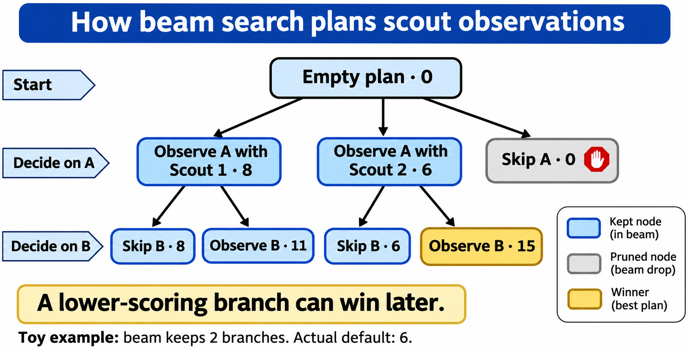

# Beam search, one decision at a time

This guide follows the planner on **observation-only** inputs. The goal is to earn points by visiting survey sites while spending as little energy as possible. Routes have to fit the observation windows, respect flight constraints, and bring each scout home.

## Read the picture from top to bottom

Each box is a partial plan. The number is its **total score so far**. Each arrow is a decision about the next site. The tree grows one site at a time.

1. Start with an empty plan worth **0**.
2. At site A, try using Scout 1 (**8**), using Scout 2 (**6**), or skipping A (**0**). In this example the beam has two slots, so the **8** and **6** plans continue.
3. At site B, extend both surviving plans. The branch that started at **8** reaches **11**. The branch that started at **6** reaches **15**. Keeping the second branch gives the planner a chance to discover the better combination.
4. The bottom row shows the candidates before pruning. Only **15** and **11** survive this round. The boxes for **8** and **6** are colored blue in the image, but both are dropped here.

Greedy commits to the best immediate choice. Beam search carries several choices forward. A wider beam can preserve more possibilities, and each extra branch costs time to expand. The real planner defaults to six slots.

## Follow the code

| Where | What happens |
|---|---|
| [`planner.py`](../planner.py) | Reads the scenario, starts the search, and writes the winning plan. The default search budget is 55 seconds from process startup. |
| [`Search.warm_start()`](../search_planner.py#L182) | Tries greedy choices first so the search starts with a fallback. The warm start can end early when its time budget runs out. |
| [`Search.run()`](../search_planner.py#L268) | Starts each pass from the empty plan. Passes consider sites in different orders, including earliest closing window and highest points. |
| [`Search.children()`](../search_planner.py#L194) | Tries adding the current observation to a scout's route. It checks up to four nearby scouts, tries preset flight settings, and yields up to two distinct valid extensions that raise the score. The caller also keeps a skip option. |
| [`IncrementalValidator`](../search_planner.py#L48) | Checks changed routes and their interactions with existing routes. The planner runs the full official scorer on archived plans before choosing what to write. |

The **beam** is the shortlist that gets expanded at the next site. The **archive** holds the best distinct plans seen anywhere in the search, up to five by default. A plan can leave the beam and still be in the archive. The **matrix** is a lookup table used by the wider planner. The boxes in the diagram are route plans.

## Where to look for improvements

| What you see in a scout-only run | What to try |
|---|---|
| Both valid extensions use the same scout with slightly different settings. | Try keeping one extension per scout before filling both slots with flight variants. Measure how many different assignments actually reach the next round. |
| An observation gets considered only after its window has become hard to fit. | Look at the route builder. Try inserting the visit between existing stops in a separate survey-only experiment, then recompute timing and validate the full plan. |
| The same sites get visited, but routes spend a lot of energy. | Try swapping two stops in the best scout tour and keep the swap only if the full plan stays valid and scores higher. |
| Many branches get dropped at the six-slot cutoff. | Compare a few beam widths under the same time limit. A wider beam can mean fewer completed passes, so judge it by final score and validity. |

Start by tracing one missed observation on an L4 observation-only case. Check whether the planner ran out of time trying candidates, rejected the route, or built a valid branch that fell below the beam cutoff. Those are three different problems and call for different changes.

For each experiment, compare the changed version with the **current search planner** on identical observation-only inputs and the same time budget. Record completed observations, energy, score, runtime, and validity. The [batch runner](benchmark_search.py) automates score comparison on its normal generated inputs. The earlier observation-only comparison filtered scenarios to scouts and removed hostile contacts before either planner ran.
